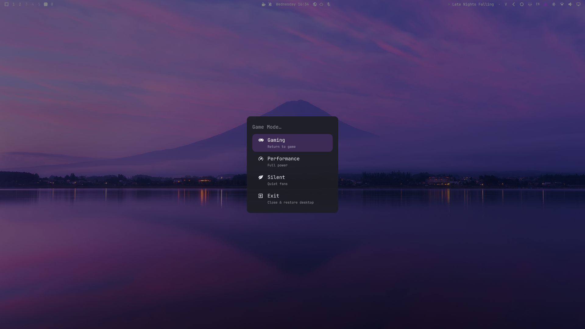

# Omarchy Game Mode 🎮



An immersive, console-style **Game Mode** plugin and utility for [Omarchy Linux](https://omarchy.org/), powered by Hyprland's hidden `special:gaming` workspace.

## Features

- **Hidden Console Space (`special:gaming`)**: Steam Big Picture and Steam games live cleanly outside your numbered workspaces (`1`–`9`), always returning you to the exact workspace you were on.
- **One-Key Instant Switch (<kbd>Super</kbd> + <kbd>G</kbd>)**: Enters Game Mode directly with zero menu friction, or toggles smoothly between your game and desktop while keeping your game running.
- **Compact Control Menu (<kbd>Super</kbd> + <kbd>Ctrl</kbd> + <kbd>G</kbd>)**: Switch between `Performance` and `Silent` profiles, jump between `Gaming` and `Desktop`, or `Exit` completely.
- **Distraction-Free Immersion**: Automatically hides the top bar (and restores it instantly even if you leave with `Super + 1`), silences notifications (DND), pauses screensaver/idle lock (controller-friendly), and pauses Nightlight — faithfully restoring your previous state on exit.
- **Auto-Restore on Exit**: Closing Steam Big Picture from your controller automatically restores your desktop.
- **Gamescope Console Isolation**: Wraps Steam Big Picture, games, and third-party launchers (Ubisoft Connect, Proton splash windows, etc.) inside a single fullscreen `gamescope` window — zero stray background windows.
- **Controller Home/Guide Launch**: Press your controller's Guide/Home button (X-Input / DualShock 4) from the desktop to jump straight into Game Mode without touching your keyboard.
- **Omarchy Bar Widget**: Shows live Game Mode status in the top bar (accent-highlighted when active), with left-click instant toggle and right-click control menu.

## External Dependencies

- `hyprland` (Omarchy default)
- `jq` (for Hyprland JSON queries)
- `steam` (for Steam Big Picture Mode)
- `gamescope` (`omarchy pkg add gamescope`, recommended for isolated single-window console mode)
- `python3` (stdlib only, for the optional controller Home button listener)
- `power-profiles-daemon` (`powerprofilesctl`, optional — for Performance / Silent power profiles)

## Installation

### 1. Add the Omarchy Bar Plugin

```bash
omarchy plugin add https://github.com/Mojarras7/omarchy-game-mode.git
omarchy bar put io.github.mojarras7.game-mode --section right
```

### 2. Install the CLI, Hyprland Rules & Keybindings

The plugin does not modify your `~/.config/hypr/` files automatically. Run the bundled installer to set up `omarchy-game-mode`, the `special:gaming` window rules, auto bar sync, and `Super + G` / `Super + Ctrl + G` bindings:

```bash
~/.config/omarchy/plugins/io.github.mojarras7.game-mode/install.sh
```

## Usage

- **<kbd>Super</kbd> + <kbd>G</kbd>** *(or left-click the bar icon)* — Enter Game Mode, or switch instantly between Game and Desktop.
- **<kbd>Super</kbd> + <kbd>Ctrl</kbd> + <kbd>G</kbd>** *(or right-click the bar icon)* — Open the compact control menu (`Desktop`, `Gaming`, `Performance`, `Silent`, `Exit`).

## Removal

```bash
omarchy bar remove io.github.mojarras7.game-mode
omarchy plugin remove io.github.mojarras7.game-mode
rm -f ~/.local/bin/omarchy-game-mode
```

Then remove the `special:gaming` rules from `~/.config/hypr/hyprland.lua` and the `omarchy-game-mode` bindings from `~/.config/hypr/bindings.lua`, and run `hyprctl reload`.

## License

MIT — see [LICENSE](LICENSE).
